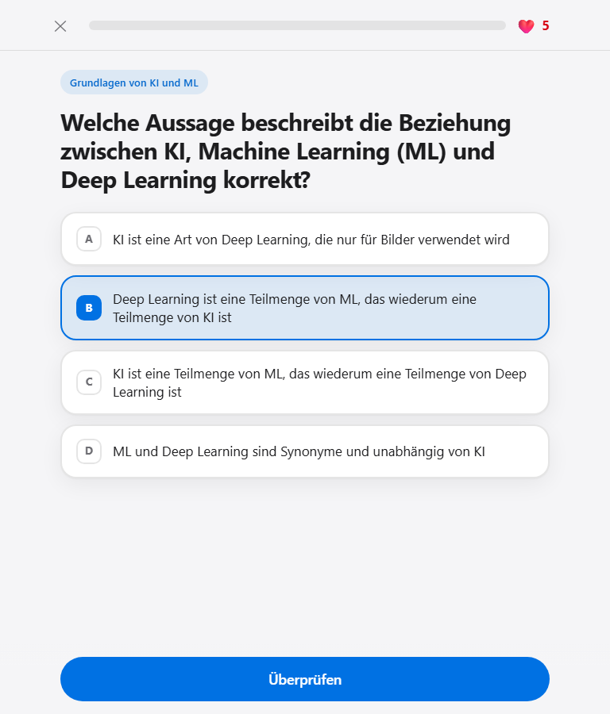

# AWS AI Practitioner Quiz

Gamifiziertes Quiz im Duolingo-Stil mit Apple-Optik zur Vorbereitung auf die Zertifizierung **AWS Certified AI Practitioner**. 15 Fragen zu den Prüfungsbereichen, mit Leben, XP, Serien-Bonus und Sternen.

**▶️ [Jetzt spielen: deniassis.github.io/aws-ai-practitioner-quiz](https://deniassis.github.io/aws-ai-practitioner-quiz/)**



## So funktioniert das Spiel

- **15 Fragen** aus fünf Bereichen: Grundlagen von KI und ML, Grundlagen generativer KI, Anwendungen von Foundation Models, verantwortungsvolle KI sowie Sicherheit, Compliance und Governance.
- Die Antworten werden in jeder Runde neu gemischt.
- Antwort wählen, **Überprüfen** tippen und die Erklärung im Feedback-Panel lesen.
- **5 Leben:** Jede falsche Antwort kostet ein Leben. Ohne Leben endet die Runde.
- **XP:** +10 pro richtiger Antwort, +5 Bonus für jede 3er-Serie.
- **Ergebnis:** bis zu 3 Sterne (ab 90 %, 70 % bzw. 50 % richtig), Genauigkeit, längste Serie und Konfetti ab 2 Sternen.
- **Falsche wiederholen** startet eine Runde nur mit den falsch beantworteten Fragen.
- Die Bestleistung wird lokal im Browser gespeichert.

**Tastatur:** `1`–`4` wählen eine Antwort, Pfeiltasten wechseln die Auswahl, `Enter` überprüft bzw. geht weiter.

**Barrierefreiheit:** semantisches HTML, sichtbarer Fokus, Screenreader-Ansagen für Feedback und Leben, Unterstützung für hellen/dunklen Modus und reduzierte Bewegung.

> Eigene Fragen, angelehnt an die Prüfungsbereiche. Es handelt sich nicht um echte Prüfungsfragen.

## Lokal starten

Das Projekt besteht nur aus HTML, CSS und JavaScript, ohne Build-Schritt und ohne Abhängigkeiten.

**Option 1:** `index.html` direkt im Browser öffnen.

**Option 2:** einen lokalen Webserver starten:

```bash
python3 -m http.server 8000
```

Unter Windows ggf. `python -m http.server 8000`. Danach im Browser [http://localhost:8000](http://localhost:8000) öffnen.

## Projektstruktur

```
index.html     Aufbau der drei Bildschirme (Start, Spiel, Ergebnis)
style.css      Gestaltung, heller/dunkler Modus, Animationen
questions.js   Die 15 Fragen (globale Konstante QUESTIONS)
app.js         Spiellogik
```

## Technik

- Reines HTML, CSS und JavaScript (Vanilla), keine Frameworks, kein npm, kein CDN
- Skripte ohne ES-Module, damit die Seite auch per Doppelklick funktioniert
- Nur relative Pfade (`./…`), damit die Seite auf GitHub Pages unter `/aws-ai-practitioner-quiz/` läuft
